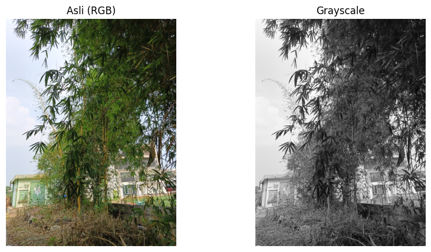
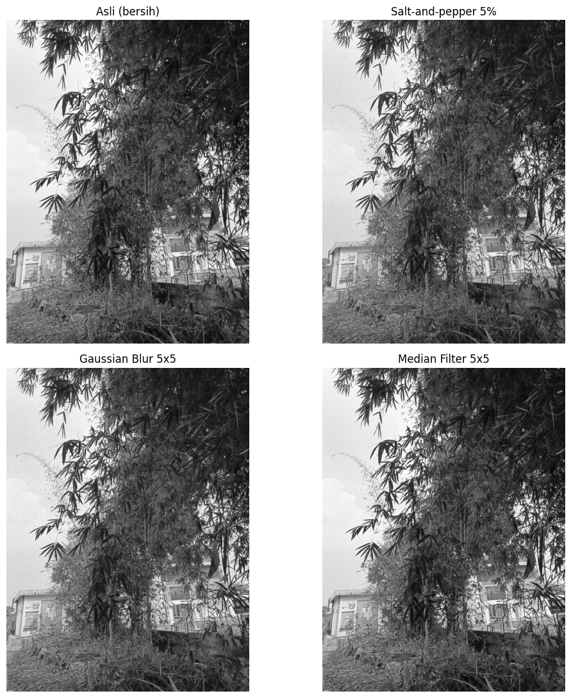
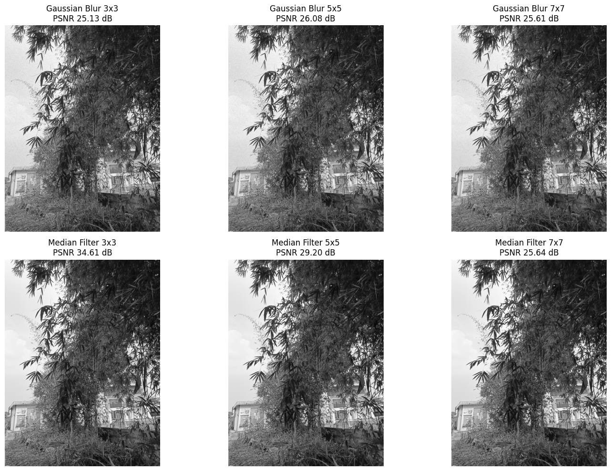

<div align="center">

# Operasi Dasar Citra Digital
### Gaussian Blur vs Median Filter untuk Salt-and-Pepper Noise

Implementasi pengolahan citra digital dengan Python untuk membandingkan **Gaussian Blur** dan **Median Filter** dalam mengurangi *salt-and-pepper noise*, dinilai secara visual dan dengan **MSE** serta **PSNR**.


</div>

---

## Daftar Isi

- [Overview](#overview)
- [Features](#features)
- [Preview dan Visualisasi](#preview-dan-visualisasi)
- [Metode yang Digunakan](#metode-yang-digunakan)
- [Tech Stack](#tech-stack)
- [Installation & Setup](#installation--setup)
- [How to Use](#how-to-use)
- [Evaluation Metrics](#evaluation-metrics)
- [Project Structure](#project-structure)
- [Learning Objectives](#learning-objectives)
- [Limitations](#limitations)
- [Author](#author)

---

## Overview

Citra digital sering terganggu *noise*. Salah satu jenisnya adalah **salt-and-pepper noise**, yaitu piksel acak yang berubah menjadi putih (255) atau hitam (0). Gangguan ini tampak sebagai bintik-bintik tajam dan sulit dihilangkan tanpa merusak detail citra.

Project ini membandingkan dua filter spasial pada kondisi yang sama:

- **Gaussian Blur**: filter linear berbasis rata-rata berbobot.
- **Median Filter**: filter non-linear berbasis nilai tengah.

Keduanya diberi citra ber-noise yang sama dan ukuran kernel yang sama, lalu hasilnya dibandingkan secara visual dan kuantitatif (MSE dan PSNR) terhadap citra grayscale asli yang bersih.

## Features

- Membaca gambar dari file JPG/PNG dengan OpenCV, dengan pesan error yang jelas jika file tidak ditemukan atau tidak valid.
- Mengubah citra RGB menjadi grayscale.
- Menambahkan salt-and-pepper noise dengan tingkat noise dan seed yang dapat diatur.
- Menerapkan Gaussian Blur dan Median Filter.
- Memvisualisasikan hasil dengan Matplotlib.
- Menghitung **MSE** dan **PSNR** terhadap citra referensi yang bersih.
- Membandingkan ukuran kernel **3×3, 5×5, dan 7×7** pada kedua metode.
- Membuat ringkasan analisis otomatis dari angka yang dihitung program.

## Preview dan Visualisasi

Gambar berikut adalah keluaran notebook yang tersimpan di folder [`assets/`](assets/). Gambar dihasilkan dari foto yang dipakai penulis saat menjalankan notebook.

**Citra asli dan grayscale**



**Perbandingan: asli, ber-noise (5%), Gaussian Blur 5×5, dan Median Filter 5×5**



**Eksperimen ukuran kernel 3×3, 5×5, dan 7×7**



### Hasil numerik dari keluaran notebook

Angka berikut disalin dari keluaran sel notebook (noise 5%, seed 42, referensi grayscale bersih). Hasil akan berbeda jika gambar, tingkat noise, atau seed diubah.

| Metode | Kernel | MSE | PSNR (dB) |
|---|:---:|---:|---:|
| Gaussian Blur | 3×3 | 199,69 | 25,13 |
| Median Filter | 3×3 | 22,52 | 34,61 |
| Gaussian Blur | 5×5 | 160,53 | 26,08 |
| Median Filter | 5×5 | 78,12 | 29,20 |
| Gaussian Blur | 7×7 | 178,61 | 25,61 |
| Median Filter | 7×7 | 177,58 | 25,64 |

Citra ber-noise tanpa filter: MSE 1120,36 dan PSNR 17,64 dB.

## Metode yang Digunakan

| Aspek | Gaussian Blur | Median Filter |
|---|---|---|
| Jenis | Linear | Non-linear |
| Cara kerja | Rata-rata berbobot; piksel dekat pusat kernel berbobot lebih besar | Nilai dalam jendela diurutkan, nilai tengah (median) dipakai |
| Fungsi OpenCV | `cv2.GaussianBlur` | `cv2.medianBlur` |
| Tujuan | Menghaluskan citra dan meredam noise | Menghapus noise impulsif |
| Pada salt-and-pepper | Nilai ekstrem 0/255 hanya diredam dan menyebar ke piksel sekitar | Nilai ekstrem terbuang karena jarang menjadi median |
| Kelebihan | Cepat, hasil halus, cocok untuk noise acak berdistribusi normal | Efektif untuk salt-and-pepper, tepi relatif lebih terjaga |
| Kekurangan | Memburamkan tepi dan detail, bintik noise tetap tampak samar | Detail tipis dan sudut dapat hilang pada kernel besar; lebih berat dihitung |

**Pengaruh ukuran kernel.** Makin besar kernel, noise makin berkurang tetapi detail (garis tipis, teks, pola) makin buram atau hilang. Ukuran kernel adalah kompromi antara pengurangan noise dan kelestarian detail.

## Tech Stack

| Teknologi | Fungsi dalam project |
|---|---|
| **Python** | Bahasa pemrograman utama |
| **OpenCV** | Membaca gambar, konversi warna, `GaussianBlur`, dan `medianBlur` |
| **NumPy** | Representasi citra sebagai array, pembuatan noise, perhitungan MSE/PSNR |
| **Matplotlib** | Visualisasi perbandingan citra |
| **Pandas** | Menyusun tabel hasil MSE dan PSNR |
| **Jupyter Notebook** | Lingkungan interaktif untuk menjalankan dan mendokumentasikan eksperimen |

## Installation & Setup

Repository ini belum menyertakan `requirements.txt`, sehingga dependency diinstal berdasarkan import pada notebook.

**1. Clone repository**

```bash
git clone https://github.com/Sahal111/Image_Filtering.git
cd Image_Filtering
```

**2. Buat virtual environment**

```bash
python -m venv venv
```

**3. Aktifkan virtual environment**

```bash
# macOS / Linux
source venv/bin/activate
```

```powershell
# Windows (PowerShell)
venv\Scripts\Activate.ps1
```

**4. Instal dependency**

```bash
pip install opencv-python numpy matplotlib pandas notebook
```

**5. Jalankan notebook**

```bash
jupyter notebook
# atau, jika memakai JupyterLab:
# pip install jupyterlab && jupyter lab
```

Buka `Operasi_Dasar_Citra_Digital_Gaussian_Median.ipynb`, lalu jalankan sel dari atas ke bawah.

## How to Use

Semua pengaturan berupa variabel di sel notebook:

| Variabel | Fungsi | Contoh |
|---|---|---|
| `NAMA_FILE_GAMBAR` | Nama file gambar JPG/PNG di folder yang sama dengan notebook | `"foto.jpg"` |
| `TINGKAT_NOISE` | Proporsi piksel yang terkena noise (0.05 = 5%) | `0.10` |
| `SEED_ACAK` | Seed acak agar hasil dapat diulang | `123` |
| `UKURAN_KERNEL` | Ukuran kernel untuk perbandingan utama (harus ganjil) | `7` |
| `daftar_kernel` | Daftar ukuran kernel pada eksperimen | `[3, 5, 7, 9]` |

Langkah singkat:

1. Gunakan `foto.jpg` bawaan, atau simpan gambar JPG/PNG Anda di folder yang sama dengan notebook.
2. Ubah `NAMA_FILE_GAMBAR` sesuai nama file.
3. Sesuaikan `TINGKAT_NOISE`, `SEED_ACAK`, dan `UKURAN_KERNEL` jika perlu.
4. Jalankan seluruh sel (*Run All*).

Jika file gambar tidak ditemukan atau tidak valid, notebook menampilkan pesan error (`FileNotFoundError` atau `ValueError`).

## Evaluation Metrics

Evaluasi dilakukan terhadap **citra grayscale asli yang bersih** sebagai referensi, sebelum noise ditambahkan.

**Mean Squared Error (MSE)**

$$\text{MSE} = \frac{1}{MN}\sum_{i=1}^{M}\sum_{j=1}^{N}\left(I(i,j) - K(i,j)\right)^2$$

Rata-rata kuadrat selisih piksel. **Makin kecil, makin mirip** dengan referensi.

**Peak Signal-to-Noise Ratio (PSNR)**

$$\text{PSNR} = 10\log_{10}\left(\frac{255^2}{\text{MSE}}\right) \text{ dB}$$

**Makin besar, makin mirip** dengan referensi. Nilai 255 adalah nilai piksel maksimum pada citra 8-bit.

| Metrik | Interpretasi |
|---|---|
| MSE kecil / PSNR besar | Hasil filter dekat dengan citra bersih |
| MSE besar / PSNR kecil | Masih banyak noise atau banyak detail yang hilang |

Keduanya tidak selalu sejalan dengan kesan visual, sehingga hasil sebaiknya dibaca bersama gambar.

## Project Structure

```text
.
├── Operasi_Dasar_Citra_Digital_Gaussian_Median.ipynb   # Notebook utama
├── README.md
├── foto.jpg                                            # Gambar input
└── assets/
    ├── 01-asli-vs-grayscale.png
    ├── 02-perbandingan-filter.png
    └── 03-eksperimen-kernel.png
```

> `foto.jpg` adalah gambar bawaan yang dirujuk `NAMA_FILE_GAMBAR`. Untuk memakai gambar lain, letakkan di folder yang sama dengan notebook dan ubah nilai `NAMA_FILE_GAMBAR`.

## Learning Objectives

- Memahami citra digital sebagai matriks piksel (grayscale 8-bit: 0 sampai 255).
- Mengenal salt-and-pepper noise dan cara mensimulasikannya.
- Memahami filtering spasial dengan kernel ganjil.
- Membedakan filter linear (Gaussian Blur) dan non-linear (Median Filter).
- Menilai kualitas citra dengan MSE dan PSNR.
- Memahami kompromi antara pengurangan noise dan kelestarian detail.

## Limitations

- Eksperimen memakai **satu gambar**, **satu jenis noise** (salt-and-pepper), dan satu seed.
- Evaluasi memerlukan citra referensi bersih. Pada kasus nyata, citra bersih sering tidak tersedia.
- Hanya memakai MSE dan PSNR; tidak ada metrik persepsi seperti SSIM.
- Gaussian Blur memakai `sigmaX=0` (sigma dihitung otomatis dari ukuran kernel); variasi sigma tidak diuji.
- Hasil dapat berbeda untuk gambar, tingkat noise, atau seed lain.

## Author

**Muhammad Sahal Anwar Hadi**
NIM: 24260032
Mata kuliah: Pengolahan Citra Digital